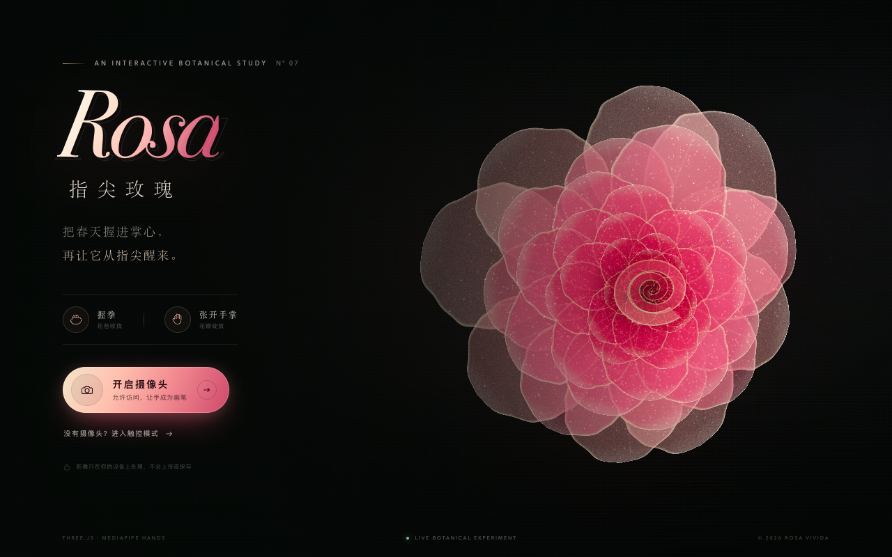
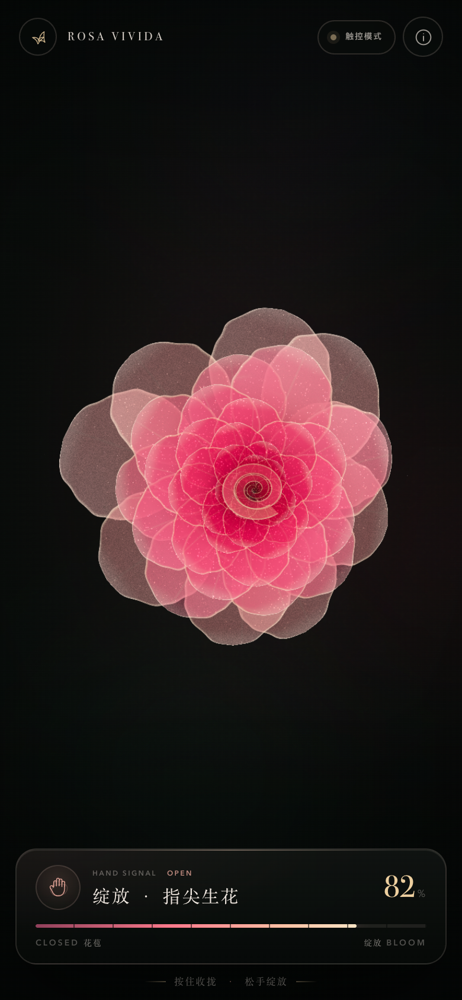

# ROSA VIVIDA · 指尖玫瑰





一朵由 49 张层叠花瓣、上万颗发光粒子和一颗螺旋花心构成的 3D 玫瑰。摄像头识别手部的 21 个关键点：

- **握拳** → 花瓣收束成花苞
- **张开手掌** → 花瓣层层向外绽放
- **移动手掌** → 玫瑰轻轻跟随，并产生视差、风动与粒子呼吸感

所有识别都在浏览器本地完成，视频与关键点不会上传。

> 截图使用内置演示模式生成，真实体验请启动本地服务并授权摄像头。

## 运行

项目零构建、零 npm 依赖，Three.js 和 MediaPipe 已放在 `vendor/`。

```bash
cd rose-bloom
npm start
# → http://localhost:5173
```

也可以用任意静态服务器，例如：

```bash
python3 -m http.server 5173
```

然后打开 `http://localhost:5173`。

## 在手机上用摄像头

手机浏览器只在 **安全上下文**（HTTPS 或 localhost）中暴露 `getUserMedia()`。通过局域网 IP 以 `http://192.168.x.x` 打开时，摄像头按钮会提示需要 HTTPS；此时仍可点「没有摄像头？进入触控模式」。

需要真机摄像头时，用内置的自签名 HTTPS 服务：

```bash
npm run dev:https
# → https://localhost:8443
# → https://<局域网IP>:8443
```

首次运行会自动用 `openssl` 生成证书到 `certs/`。手机访问局域网 HTTPS 地址时，浏览器会提示证书不受信任：选择「继续访问 / 高级 → 继续前往」即可。`getUserMedia` 在用户手动信任后可用。

## 触控体验

没有摄像头也没关系：

- 点击「没有摄像头？进入触控模式」
- **按住**画面任意处 → 花苞收拢
- **松手** → 玫瑰绽放
- 移动指针 → 花朵轻微跟随
- 桌面端也可用空格键模拟握拳

自动演示 / 截图模式：

```text
/?demo=1                 自动绽放循环，跳过开场
/?demo=1&bloom=0.92      固定在完全盛开
/?demo=1&bloom=0.02      固定在花苞
```

## 手势识别逻辑

`src/hand-tracker.js` 将 MediaPipe 的 21 个归一化关键点转换为 0–1 的“手掌张开度”：

- 四指指尖到手腕的距离 / 手掌尺度
- 每根手指的 PIP 关节直角度（伸直 vs 蜷曲）
- 拇指的独立权重
- 指数平滑，减少抖动

主循环把张开度映射为玫瑰的 bloom 值，并用弹簧式缓动驱动花瓣展开；变化速度会产生额外的粒子能量。手在屏幕上的位置会转换到 3D 场景，带来轻微的位移与旋转视差。

## 结构

```text
rose-bloom/
├── index.html              UI 与开场
├── styles.css              移动端视觉
├── src/
│   ├── main.js             状态机、触控、渲染循环
│   ├── hand-tracker.js     camera + MediaPipe + 手势计算
│   └── rose-scene.js       Three.js 粒子玫瑰与自定义 GLSL
├── server.mjs              零依赖静态服务器（HTTP / HTTPS）
├── vendor/
│   ├── three.module.js
│   └── mediapipe/          Tasks Vision WASM + hand_landmarker.task
└── assets/favicon.svg
```

## 视觉实现

- 49 张程序化花瓣卡片：外圈舒展、内圈收拢，以柔和透明与金色边光叠出花瓣层次
- 每片花瓣上散布粒子，粒子与花瓣共享同一套 bloom / 风动 / 手部视差变形
- 花心是一条由深酒红卷向金色的程序化螺旋，形成玫瑰的标志性视觉中心
- 握拳时切换为 3D 粒子花苞，花瓣粒子向外飞散完成从花苞到盛放的过渡
- 顶点着色器同时计算花苞与盛开两套形态，按层错峰插值
- 叠加式辉光、体积光晕、漂浮尘埃、胶片颗粒
- 根据视口比例自动取景；移动端降低粒子细节和像素比
- 不可见的花苞或花瓣会自动停止绘制，减少移动端 GPU 压力

## 常见问题

**摄像头按钮没反应 / 没有权限提示**  
检查地址是否为 `localhost` 或 HTTPS。普通局域网 HTTP 地址无法使用摄像头，这是浏览器的安全限制。

**手机发热或掉帧**  
手势模型本身会占用 GPU。可关闭其他相机应用、降低屏幕亮度，或继续使用触控模式。

**MediaPipe 模型加载失败**  
确认 `vendor/mediapipe/hand_landmarker.task` 与 `vendor/mediapipe/wasm/` 完整存在，并通过 HTTP 访问，不要直接双击 `index.html`（`file://` 下 ES Module 与 WASM 都会被浏览器拦截）。

**自签名证书仍有警告**  
在手机的证书警告页选择继续。若企业策略禁止，改用 localhost 端口转发或受信任的 HTTPS 隧道。

## 技术栈与致谢

- [Three.js](https://threejs.org/) r164（MIT）
- [MediaPipe Tasks Vision — HandLandmarker](https://ai.google.dev/edge/mediapipe/solutions/vision/hand_landmarker)（Apache-2.0）
- 原生 HTML / CSS / ES Modules，无构建步骤

第三方依赖许可见 [THIRD_PARTY_NOTICES.md](THIRD_PARTY_NOTICES.md)。

手势与视觉均为本项目原创实现。镜头影像只在浏览器内存中用于实时推理，不写入磁盘、不上传服务器。
